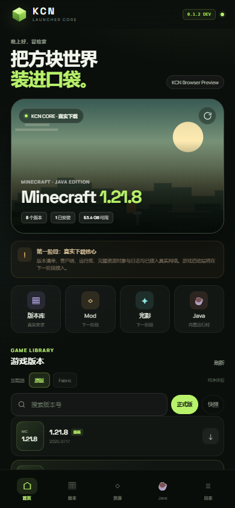

# KCN 启动器

> 把方块世界装进口袋。一个面向 Android 的 Minecraft Java 版启动器项目。

KCN 是一个独立开发的移动端启动器项目，包含两套界面与实现：

- `android-app/`：KCN 自己的 Android 应用（包名 `com.kcn.launcher`），自研下载核心、原生桥、Modrinth 接入、OpenJDK 解压和日志。
- `src/`：KCN 的 Web 设计预览，用于验证移动端启动器视觉与交互，不参与 Android 启动。



## 当前状态

**开发中，尚不可启动游戏。**

| 模块 | 状态 |
| --- | --- |
| Mojang / BMCLAPI 版本清单 | 已完成 |
| 版本 JSON / client.jar / libraries / assets | 已完成 |
| Fabric Loader 安装 | 已完成 |
| 已安装实例与切换 | 已完成 |
| Modrinth Mod / 光影下载 | 已完成 |
| 内置 OpenJDK 21 解压 | 已完成 |
| 下载队列 / 实时日志 | 已完成 |
| **JVM / LWJGL 游戏启动层** | **未完成** |
| Forge / NeoForge / 登录 / 触控 | 未开始 |

`KCN Core 0.1.4` 是开发里程碑，不是最终可玩版本。

## 下载

最新 APK 与校验值请前往 [Releases](https://github.com/houshibo0101/KCN/releases)。

- 包名：`com.kcn.launcher`
- 要求：Android 8.0+；Java 运行时解压需要 arm64 设备
- 当前版本：`0.1.4`
- SHA-256：`6F9101A46F164AE28204F8F667EAA1B1017E1DE503DDBA57840EA44EAA13874E`

## 已实现能力

- Mojang / BMCLAPI 双源版本清单，本地缓存与镜像回退
- 版本元数据、`client.jar`、libraries、assets 索引与资源对象真实下载
- Fabric Loader 元数据、依赖库和版本配置
- 已安装实例列表与当前实例切换
- 启动计划生成：classpath、mainClass、Java 路径和 JVM 参数
- Modrinth 搜索、游戏版本匹配和 Mod / 光影文件下载
- 内置 OpenJDK 21 解压到应用私有目录
- 原生下载任务进度、实时日志与错误日志
- KCN 自有 Android 界面，非 FCL 换皮

## 构建 Android

前置：JDK 17、Android SDK 34。

```bash
cd android-app
# local.properties 中写入 sdk.dir=/path/to/android-sdk
./gradlew assembleDebug
```

产物：`android-app/app/build/outputs/apk/debug/app-debug.apk`

更完整的构建、签名和真机步骤见 [构建指南](https://github.com/houshibo0101/KCN/wiki/Build)。

## 构建 Web 预览

```bash
npm install
npm run dev
```

生产构建：

```bash
npm run build
npm run preview
```

## 项目结构

```text
android-app/
  app/src/main/java/com/kcn/launcher/
    MainActivity.java     WebView 容器
    KcnBridge.java        版本 / 资源 / Java / 日志原生桥
  app/src/main/assets/web/ KCN Android 界面
  app/src/main/assets/runtime/jre21/ 内置 OpenJDK
src/                       Web 设计预览
docs/images/               文档截图
release/                   发布说明与校验值
```

## Wiki

项目文档、安装步骤、架构和路线图都在 [KCN Wiki](https://github.com/houshibo0101/KCN/wiki)：

- [安装指南](https://github.com/houshibo0101/KCN/wiki/Installation)
- [构建指南](https://github.com/houshibo0101/KCN/wiki/Build)
- [项目架构](https://github.com/houshibo0101/KCN/wiki/Architecture)
- [路线图](https://github.com/houshibo0101/KCN/wiki/Roadmap)
- [更新日志](https://github.com/houshibo0101/KCN/wiki/Changelog)

## 开源与致谢

KCN 应用层代码以 **GPL-3.0** 发布，见 [LICENSE](LICENSE)。

运行时涉及 OpenJDK、LWJGL 等开源组件；KCN 与 Mojang Studios、Microsoft、FCL-Team 无隶属关系。Minecraft 是 Mojang Studios 的商标。

---

如果这个项目对你有帮助，欢迎 Star、提交 Issue 或参与 Wiki 完善。
